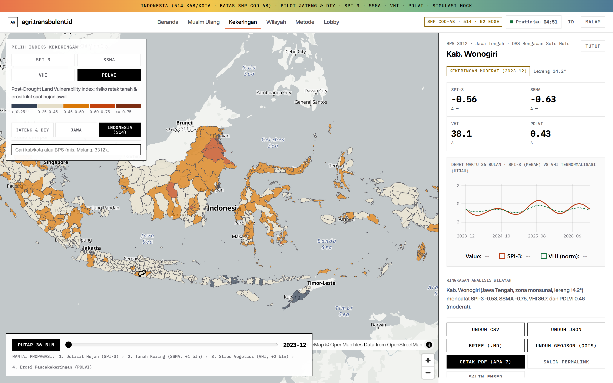
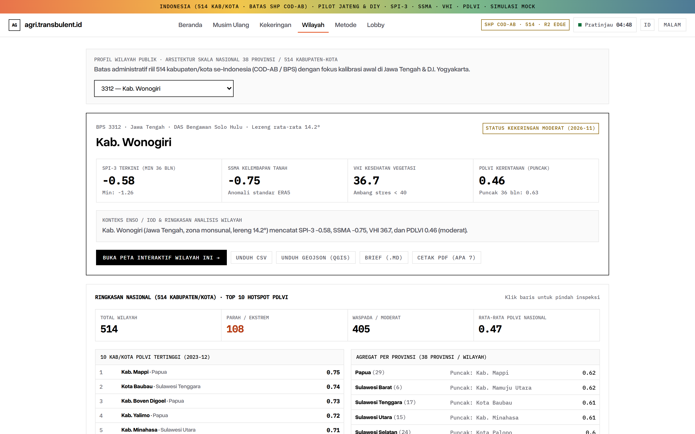
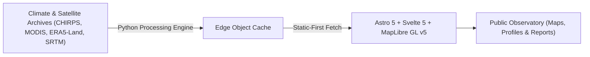

<div align="center">

# Drought in Control — Indonesian Soil-Landscape Drought & Land Vulnerability Observatory (`PDLVI`)

**Open-source geospatial drought monitoring (`SPI-3`, `SSMA`, `VHI`) and Post-Drought Land Vulnerability Index (`PDLVI`) across all 514 Indonesian regencies and cities.**

**Observatorium geospasial *static-first* untuk pemantauan kekeringan lahan (`SPI-3`, `SSMA`, `VHI`) dan Indeks Kerentanan Lahan Pascakekeringan (`PDLVI`) di 514 kabupaten/kota se-Indonesia.**

[](https://agri.transbulent.id/kekeringan/)
[](https://agri.transbulent.id/wilayah/)
[](./web/)
[](./pipeline/)
[](./CITATION.cff)

[English](#-english) · [Bahasa Indonesia](#-bahasa-indonesia) · [Live Observatory](https://agri.transbulent.id/kekeringan/) · [Regional Profiles](https://agri.transbulent.id/wilayah/) · [Citation](#-citation--sitasi)

</div>

---

<p align="center">
  
</p>

<table>
  <tr>
    <td width="50%" align="center">
      
      <br />
      <sub><strong>Nationwide View / Peta Nasional (514 Kab/Kota)</strong> — Real COD-AB/BPS administrative boundaries</sub>
    </td>
    <td width="50%" align="center">
      
      <br />
      <sub><strong>Regional Profiles / Profil Wilayah</strong> — Hotspot PDLVI ranking &amp; province aggregation</sub>
    </td>
  </tr>
</table>

---

## 🇬🇧 English

### Overview

Standard drought monitors often stop at meteorological rainfall deficits and miss two critical dynamics across tropical monsoonal landscapes:
1. **Propagation Lag**: A meteorological rainfall deficit (`SPI-3`) progresses over weeks to months before depleting root-zone soil moisture (`SSMA`) and triggering vegetation canopy stress (`VHI`).
2. **Post-Drought Land Vulnerability (`PDLVI`)**: When intense onset monsoon rains hit desiccated, cracked clay slopes, surface runoff, flash erosion, and shallow landslide hazards rise sharply—captured by the **Post-Drought Land Vulnerability Index (`PDLVI`)**.

**Drought in Control** combines satellite/climate indicators with terrain susceptibility inside a fast, static-first Swiss census web interface ([`agri.transbulent.id/kekeringan/`](https://agri.transbulent.id/kekeringan/)).

### Key Features

- **All 514 Indonesian Regencies & Cities (BMKG 3 Climate Zones)**: Topology-preserved COD-AB / BPS administrative boundaries spanning 38 provinces with zone-calibrated thresholds across **Monsunal**, **Ekuatorial**, and **Lokal** rainfall regimes (Aldrian & Susanto, 2003), interactive zone filtering (`?zone=`), and national zone aggregates.
- **Propagation Lag-AI & AR(1) 3-Month Probabilistic Forecast**: Computes empirical Pearson cross-correlation lags (`SPI-3 → SSMA → VHI → PDLVI`), recursive autoregressive `T+1..T+3` forecasts with 90% confidence intervals, and calibrated `P(AWAS)` exceedance probability.
- **Zero-Hallucination Grounded AI Policy Copilot**: Edge synthesis endpoint (`POST /api/v1/ai/brief`) powered by Gemini 3.8 Flash and guarded by an automated numeric validator that rejects fabricated figures and falls back cleanly to verified outputs.
- **Google Colab + Earth Engine On-Demand Extraction (Strict Quota & 14-Day Shared Cache)**: Region-scoped Colab notebook (`notebooks/drought_gee_analysis.ipynb`) pulling real CHIRPS, MODIS, ERA5-Land, and SRTM archives with a **cache-first edge gateway** (`0` quota consumed on cache hits; strict daily cap `2/day` for signed-in Google accounts and `1/day` for guests with a `15-min` cooldown), plus mandatory **180s idle + post-export `runtime.unassign()`** auto-shutdown.
- **60 fps GPU Choropleth & 36-Month Scrubber**: Switch instantaneously across `SPI-3`, `SSMA`, `VHI`, and `PDLVI` or animate 36 monthly frames smoothly without re-uploading vector geometry.
- **Publication-Ready Exports, D1 Shortlinks & QGIS Compatibility**: Download clean `.csv`, `.json`, **QGIS-ready `.geojson`**, Markdown briefs, or print PDF Policy Briefs formatted with **APA 7th Edition** citations (including Aldrian & Susanto, 2003), and share compact D1 shortlinks (`/s/[slug]`).
- **Agronomy Cross-Link (`Panen-ID`)**: Jump directly from drought-monitored regions into field-scale seasonal yield & soil replay analysis via [`/ulang/`](https://agri.transbulent.id/ulang/bompon-magelang/mt2-2025/).

### Scientific Indicators & Pipeline Architecture

| Indicator | Name | Physical Domain | Propagation Role |
| --- | --- | --- | --- |
| **`SPI-3`** | 3-Month Standardized Precipitation Index | CHIRPS Daily Precipitation | Meteorological deficit onset |
| **`SSMA`** | Surface Soil Moisture Anomaly | ERA5-Land (`0–7 cm`) | Soil water depletion (+1 month lag) |
| **`VHI`** | Vegetation Health Index | MODIS NDVI & Land Surface Temp | Canopy greenness & thermal stress |
| **`PDLVI`** | Post-Drought Land Vulnerability Index | Composite drought deficit × SRTM slope | Erosion & crack-infiltration hazard at rain onset |



### Security & Transparency

- **Zero Credentials in Source Control**: External API and storage credentials are supplied strictly via runtime environment variables / CI secrets.
- **Verified Numerical Integrity**: Automated narrative summaries undergo strict quantitative checks against computed pipeline metrics prior to publication.
- **Explicit Provenance**: Synthetic/offline datasets are transparently marked (`SIMULASI`) in both the interface and every exported file.

### Local Quickstart

```bash
# 1. Start or build the web observatory (Astro 5 + Svelte 5)
cd web
npm install
npm run dev      # Local dev server
npm run build    # Production static build in web/dist/

# 2. Run pipeline unit tests & offline dry-run (Python 3.11+ stdlib only)
cd ..
python -m unittest discover -s pipeline -p "test_*.py" -v
python pipeline/run_pipeline.py --dry-run
```

---

## 🇮🇩 Bahasa Indonesia

### Ringkasan

Pemantauan kekeringan konvensional umumnya hanya melihat defisit hujan dan melewatkan dua proses kunci di wilayah monsunal tropis:
1. **Jeda Perambatan (*Propagation Lag*)**: Defisit curah hujan (`SPI-3`) merambat dalam hitungan minggu hingga bulan sebelum menguras kelembapan tanah (`SSMA`) dan menekan kesehatan tajuk vegetasi (`VHI`).
2. **Kerentanan Lahan Pascakekeringan (`PDLVI`)**: Saat hujan awal musim berintensitas tinggi mengguyur lereng tanah liat yang retak seusai kemarau, risiko erosi kilat dan longsor dangkal meningkat tajam—dipetakan melalui indeks **`PDLVI`**.

**Drought in Control** menyajikan indikator hidrometeorologi dan kerentanan topografi tersebut dalam antarmuka kartografi minimalis berkecepatan tinggi di [`agri.transbulent.id/kekeringan/`](https://agri.transbulent.id/kekeringan/).

### Fitur Utama

- **514 Kabupaten/Kota Se-Indonesia (3 Zona Iklim BMKG)**: Batas administratif riil berkode BPS 4-digit lintas 38 provinsi dengan kalibrasi ambang khusus untuk pola hujan **Monsunal**, **Ekuatorial**, dan **Lokal** (Aldrian & Susanto, 2003), filter zona interaktif (`?zone=`), serta ringkasan agregat nasional di [`/wilayah/`](https://agri.transbulent.id/wilayah/).
- **AI Propagasi Lag & Prakiraan Probabilistik AR(1) 3 Bulan**: Menghitung jeda korelasi silang Pearson (`SPI-3 → SSMA → VHI → PDLVI`), prakiraan rekursif `T+1..T+3` lengkap dengan selang kepercayaan 90%, dan probabilitas status **`P(AWAS)`**.
- **Copilot Kebijakan AI Anti-Halusinasi**: Endpoint sintesis tepi (`POST /api/v1/ai/brief`) bertenaga Gemini 3.8 Flash yang dijaga validator numerik otomatis—menolak angka fabrikasi dan beralih mulus ke keluaran deterministik terverifikasi.
- **Google Colab + Earth Engine Sesuai Permintaan (Kuota Ketat & Shared Cache 14 Hari)**: Notebook wilayah otomatis (`notebooks/drought_gee_analysis.ipynb`) yang menarik arsip CHIRPS, MODIS, ERA5-Land, dan SRTM dengan pola **cache-first** (`0` kuota saat *cache hit*; batas harian ketat `2/hari` untuk akun Google & `1/hari` untuk tamu dengan jeda `15 menit`), dilengkapi auto-shutdown wajib (`idle 180 detik` + `runtime.unassign()`).
- **Peta Choropleth 60 fps & Scrubber 36 Bulan**: Berpindah instan antara `SPI-3`, `SSMA`, `VHI`, dan `PDLVI` beserta animasi bulanan tanpa jeda.
- **Ekspor Riset, Tautan Singkat D1 & Siap QGIS**: Unduh `.csv`, `.json`, **`.geojson` siap QGIS**, ringkasan `.md`, cetak PDF Policy Brief rapi (`@media print`) dengan sitasi **APA Edisi ke-7** (+ Aldrian & Susanto, 2003), serta salin tautan singkat D1 (`/s/[slug]`).
- **Antarmuka 4 Bahasa**: Pengalih bahasa instan (`ID | EN | JA | ZH`) dengan pencarian cepat 514 kabupaten/kota (*fly-to* otomatis).

### Keamanan & Integritas Data

- **Tanpa Rahasia atau Kunci API di Repositori**: Seluruh kredensial operasional disuntikkan hanya melalui environment variables saat eksekusi.
- **Validasi Angka Otomatis**: Ringkasan naratif diverifikasi agar setiap angka konsisten dengan keluaran hitungan pipeline.
- **Penanda Provenans Jelas**: Data simulasi/offline selalu berlabel `SIMULASI` baik di layar maupun pada berkas unduhan.

---

## Documentation / Dokumentasi

| Document | Description |
| --- | --- |
| [`docs/ARCHITECTURE.md`](./docs/ARCHITECTURE.md) | High-level system architecture, visual design tokens & provenance rules |
| [`docs/SCIENCE_AND_DATA.md`](./docs/SCIENCE_AND_DATA.md) | Scientific formulation for `SPI-3`, `SSMA`, `VHI`, `PDLVI` & citation templates |
| [`docs/ROADMAP.md`](./docs/ROADMAP.md) | Public feature milestones & upcoming multi-climate calibration |
| [`docs/PROGRESS.md`](./docs/PROGRESS.md) | Completed milestone verification summary |
| [`CHANGELOG.md`](./CHANGELOG.md) | Release history |

## 📜 Citation / Sitasi

See [`CITATION.cff`](./CITATION.cff) or cite using **APA 7th Edition**:

> Transbulent Research Group. (2026). *Drought in Control — Indonesian Soil-Landscape Drought & Land Vulnerability Observatory (PDLVI)* (Version 0.9.0) [Computer software]. https://github.com/gisrad/drought-in-control

```bibtex
@software{transbulent_drought_in_control_2026,
  author       = {{Transbulent Research Group}},
  title        = {{Drought in Control: Indonesian Soil-Landscape Drought & Land Vulnerability Observatory (PDLVI)}},
  year         = {2026},
  version      = {0.9.0},
  url          = {https://agri.transbulent.id/kekeringan/},
  repository   = {https://github.com/gisrad/drought-in-control},
  license      = {MIT}
}
```
