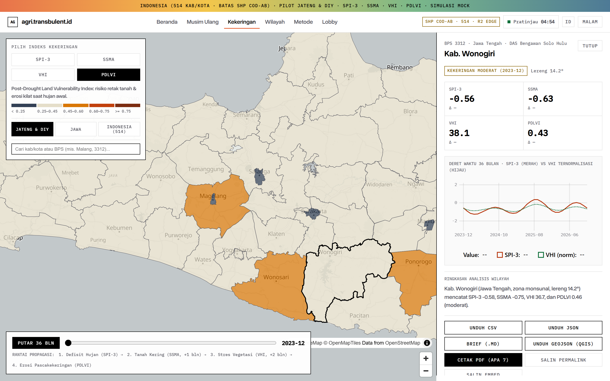
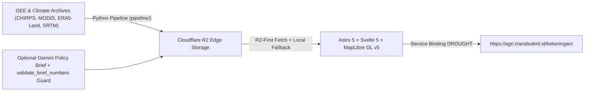

<div align="center">

# Drought in Control — Soil-Landscape Drought & Land Vulnerability Observatory (`PDLVI`)

**Open-source geospatial drought monitoring (`SPI-3`, `SSMA`, `VHI`) and Post-Drought Land Vulnerability Index (`PDLVI`) across all 514 Indonesian regencies & cities.**

**Observatorium geospasial *static-first* untuk pemantauan kekeringan lahan (`SPI-3`, `SSMA`, `VHI`) dan Indeks Kerentanan Lahan Pascakekeringan (`PDLVI`) di 514 kabupaten/kota se-Indonesia.**

[](https://agri.transbulent.id/kekeringan/)
[](https://agri.transbulent.id/wilayah/)
[](./web/)
[](./pipeline/)
[](./CITATION.cff)

[English](#-english) · [Bahasa Indonesia](#-bahasa-indonesia) · [Live Map](https://agri.transbulent.id/kekeringan/) · [Regional Profiles](https://agri.transbulent.id/wilayah/) · [Citation](#-citation--sitasi)

</div>

---

<p align="center">
  
</p>

<table>
  <tr>
    <td width="50%" align="center">
      
      <br />
      <sub><strong>Nationwide View / Peta Nasional (514 Kab/Kota)</strong> — Real COD-AB/BPS polygons with GPU paint expressions</sub>
    </td>
    <td width="50%" align="center">
      
      <br />
      <sub><strong>Public Profiles / Profil Wilayah (<code>/wilayah/</code>)</strong> — Top 10 PDLVI hotspots &amp; province aggregation</sub>
    </td>
  </tr>
</table>

---

## 🇬🇧 English

### Why Drought in Control?

Conventional drought dashboards stop at rainfall deficits and miss two physical realities in tropical monsoonal watersheds:
1. **Propagation Lag**: Meteorological deficit (`SPI-3`) takes weeks to months before depleting root-zone moisture (`SSMA`) and triggering vegetation thermal/greenness stress (`VHI`).
2. **Post-Drought Land Vulnerability (`PDLVI`)**: When heavy onset rains strike desiccated, cracked clay hillslopes, erosion and shallow landslide susceptibility spike sharply—captured by our **Post-Drought Land Vulnerability Index (`PDLVI`)**.

Designed in sharp Swiss census minimalism (`0px` grid hairlines, tabular monospace telemetry, high-contrast color ramps), `drought-in-control` runs **Pillar 2** of [`agri.transbulent.id`](https://agri.transbulent.id) via Cloudflare Workers Service Bindings (`/kekeringan/*`, `/wilayah/*`) while remaining standalone and reproducible.

### Core Capabilities

- **514 Real Indonesian Regencies & Cities**: Topology-preserved administrative boundaries derived from COD-AB / BPS 4-digit codes across all 38 provinces, starting with high-resolution pilot calibration in Central Java & D.I. Yogyakarta.
- **60 fps GPU Choropleth Rendering**: Switches instantly across **4 drought indices** (`SPI-3`, `SSMA`, `VHI`, `PDLVI`) and **36 monthly frames** using MapLibre GL v5 `match` paint expressions without re-uploading GeoJSON buffers.
- **Interactive Discovery & Quick Jump**: Live 514-regency search bar (*kode BPS*, regency, or province) with instant `flyTo`, real-time hover telemetry, `Jateng & DIY` / `Jawa` / `Indonesia (514)` viewport presets, and multilingual UI (`ID | EN | JA | ZH`).
- **One-Click Scientific Reporting & QGIS Exports**: Region Inspector drawer featuring **uPlot** multi-series timelines, CSV/JSON/Markdown downloads, **QGIS-ready GeoJSON** subset export with provenance metadata, and print-ready PDF Policy Briefs formatted with **APA 7th Edition** citations.
- **Stateful Sharing & Embeds**: Share exact map views via stateful permalinks (`?kode=&idx=&m=`) or borderless iframe embeds (`?embed=1`).
- **Cross-Pillar Agronomy Bridge**: Direct deep-links from drought-stressed regencies (such as Magelang/DAS Bompon and Klaten) into field-level **Season Replay** ([`panen-id`](https://github.com/gisrad/panen-id)) under [`/ulang/`](https://agri.transbulent.id/ulang/bompon-magelang/mt2-2025/).

### Scientific Indices & Pipeline

| Index | Full Name | Physical Source | Role in Propagation Chain |
| --- | --- | --- | --- |
| **`SPI-3`** | 3-Month Standardized Precipitation Index | CHIRPS Daily / GPM | Meteorological rainfall deficit onset |
| **`SSMA`** | Surface Soil Moisture Anomaly | ERA5-Land (`volumetric_soil_water_layer_1`) | Root-zone soil moisture depletion (+1 month lag) |
| **`VHI`** | Vegetation Health Index (`VCI` + `TCI`) | MODIS `MOD13A2` & `MOD11A2` | Canopy greenness & thermal stress (`< 40` threshold) |
| **`PDLVI`** | Post-Drought Land Vulnerability Index | `0.35·VHI + 0.40·SSMA + 0.25·SPI-3` × SRTM slope factor | Desiccation cracking & flash-erosion hazard at monsoon onset |



### Security, Privacy & Data Integrity

- **Zero Hardcoded Secrets**: Live Google Earth Engine (`GEE_SERVICE_ACCOUNT`), Cloudflare R2 (`R2_ENDPOINT`, `R2_ACCESS_KEY_ID`, `R2_SECRET_ACCESS_KEY`), and Gemini API credentials are read exclusively from runtime environment variables or GitHub Actions Secrets (`${{ secrets.* }}`).
- **Anti-Hallucination Brief Validator**: `pipeline/ai_summarizer.py` enforces `validate_brief_numbers(...)` to reject any generated text containing quantitative claims ungrounded in computed pipeline metrics.
- **Explicit Provenance Labeling**: Synthetic/dry-run series are transparently tagged `is_simulated: true` / `SIMULASI` across both UI badges and downloaded CSV/GeoJSON/Markdown exports.
- **Edge Security**: Enforced HTTPS, strict `Content-Security-Policy` headers, `X-Content-Type-Options: nosniff`, and conditional `frame-ancestors` restricted strictly to `https://*.transbulent.id` when `?embed=1` is requested.

### Quickstart (Local Development & Offline Pipeline)

```bash
# 1. Frontend (Astro 5 + Svelte 5 + MapLibre GL v5 + uPlot)
cd web
npm install
npm run dev      # http://127.0.0.1:4326
npm run build    # Static build in web/dist/

# 2. Python Pipeline Unit Tests & Offline Dry-Run (stdlib only — no API keys required)
cd ..
python -m unittest discover -s pipeline -p "test_*.py" -v
python pipeline/run_pipeline.py --dry-run
```

---

## 🇮🇩 Bahasa Indonesia

### Mengapa Drought in Control?

Banyak sistem pemantauan kekeringan berhenti pada defisit curah hujan dan melewatkan dua kenyataan fisik di DAS tropis bermusim monsun:
1. **Jeda Perambatan (*Propagation Lag*)**: Defisit hujan (`SPI-3`) membutuhkan waktu berminggu-minggu hingga berbulan-bulan sebelum menguras kelembapan tanah lapisan akar (`SSMA`) dan memicu stres vegetasi (`VHI`).
2. **Kerentanan Lahan Pascakekeringan (`PDLVI`)**: Ketika hujan lebat awal musim menghantam lereng tanah liat yang retak setelah kemarau panjang, risiko erosi kilat dan longsor dangkal melonjak tajam — dipetakan oleh indeks **`PDLVI`**.

Dibangun dengan desain minimalis *Swiss census* (`0px` sudut tajam, garis *hairline*, angka *tabular monospace*, dan palet kontras teruji WCAG), **`drought-in-control`** melayani **Pilar 2** pada [`agri.transbulent.id`](https://agri.transbulent.id/kekeringan/) sekaligus dapat dijalankan mandiri secara lokal.

### Fitur Utama

- **514 Kabupaten/Kota Riil Se-Indonesia**: Batas administratif riil berkode BPS 4-digit lintas 38 provinsi (sumber COD-AB/BPS) dengan kalibrasi awal di Jawa Tengah & D.I. Yogyakarta.
- **Peta Choropleth 60 fps**: Berpindah instan di antara 4 indeks (`SPI-3`, `SSMA`, `VHI`, `PDLVI`) dan *scrubber* 36 bulan (*Play/Pause*) memakai ekspresi GPU `match` MapLibre GL v5 tanpa mengunggah ulang GeoJSON per frame.
- **Pencarian Cepat & Peringkat Hotspot Nasional (`/wilayah/`)**: Filter langsung 514 kabupaten/kota (*fly-to* otomatis), *readout* hover real-time, pemilih viewport (`Jateng & DIY`, `Jawa`, `Indonesia (514)`), agregat 38 provinsi, serta tabel klik **Top 10 Hotspot PDLVI Tertinggi**.
- **Ekspor Riset & Siap QGIS**: Unduh `.csv`, `.json`, **`.geojson` siap buka di QGIS**, ringkasan `.md`, dan cetak PDF Policy Brief rapi lewat `@media print` lengkap dengan daftar pustaka **APA Edisi ke-7**.
- **Berbagi Berkeadaan & Multi-Bahasa**: Permalink (`?kode=&idx=&m=`), mode embed `<iframe>` (`?embed=1`), serta antarmuka 4 bahasa (`ID | EN | JA | ZH`).
- **Jembatan Lintas Pilar ke `Panen-ID`**: Tautan langsung dari kabupaten terdampak menuju analisis pertumbuhan tanaman & tanah presisi di [`/ulang/`](https://agri.transbulent.id/ulang/bompon-magelang/mt2-2025/).

### Keamanan, Privasi & Integritas Data

- **Tanpa Kredensial Tertanam**: Seluruh secret GEE, Cloudflare R2, dan Gemini dibaca strictly dari environment variables / GitHub Secrets.
- **Penjaga Anti-Halusinasi Angka (`validate_brief_numbers`)**: Ringkasan teks otomatis divalidasi secara ketat agar setiap angka yang tampil cocok dengan luaran terhitung pipeline.
- **Transparansi Provenans Data**: Data simulasi/dry-run selalu ditandai eksplisit (`is_simulated: true` / lencana `SIMULASI`) pada tampilan peta maupun setiap berkas ekspor.

---

## Documentation / Indeks Dokumentasi

| File | Scope |
| --- | --- |
| [`docs/ARCHITECTURE.md`](./docs/ARCHITECTURE.md) | Federated 3-repo architecture, Cloudflare Service Binding, Swiss tokens & `@media print` |
| [`docs/SCIENCE_AND_DATA.md`](./docs/SCIENCE_AND_DATA.md) | Formulations for `SPI-3`, `VHI`, `SSMA`, `PDLVI`, R2 JSON schema & APA 7th rules |
| [`docs/ROADMAP.md`](./docs/ROADMAP.md) | Staged build milestones `D0–D5` |
| [`docs/PROGRESS.md`](./docs/PROGRESS.md) | Verified build checkpoints, bundle budgets & deployment log |
| [`CHANGELOG.md`](./CHANGELOG.md) | Versioned release history |

## 📜 Citation / Sitasi

Metadata sitasi tersedia pada [`CITATION.cff`](./CITATION.cff) atau gunakan format **APA 7th**:

> Transbulent Research Group. (2026). *Drought in Control — Soil-Landscape Drought & Post-Drought Land Vulnerability Index (PDLVI) Observatory* (Version 0.8.0) [Computer software]. https://github.com/gisrad/drought-in-control

```bibtex
@software{transbulent_drought_in_control_2026,
  author       = {{Transbulent Research Group}},
  title        = {{Drought in Control: Soil-Landscape Drought & Post-Drought Land Vulnerability Index (PDLVI) Observatory}},
  year         = {2026},
  version      = {0.8.0},
  url          = {https://agri.transbulent.id/kekeringan/},
  repository   = {https://github.com/gisrad/drought-in-control},
  license      = {MIT}
}
```
